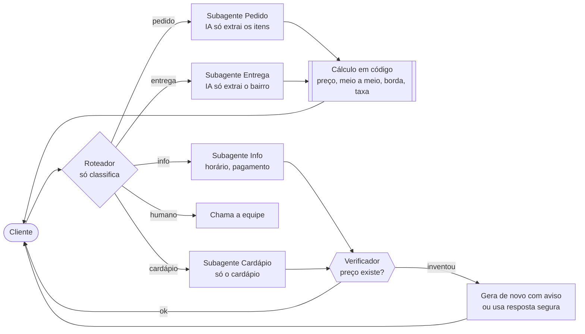

# 🍕 Atendente de IA para pizzaria: prompt único x subagentes

[](https://github.com/MChaves-21/atendimento-pizzaria-ia/actions/workflows/testes.yml)


Um assistente de IA que **inventa** preço, sabor ou bairro de entrega faz a empresa perder dinheiro e o cliente perder a confiança. Este projeto compara duas formas de montar o mesmo atendente e **mede** quantas respostas inventadas cada uma produz:

1. **Prompt único:** todos os dados e todas as regras num só texto, e o modelo responde e faz as contas sozinho. É o jeito mais comum de começar.
2. **Subagentes:** um roteador classifica a mensagem e um subagente por fase atende, com um prompt curto e só os dados daquela fase. Preços, taxas e totais são calculados **em código**, e um **verificador** barra qualquer preço que não exista antes de a resposta chegar ao cliente.

> A "Pizzaria Bella Massa", o cardápio, os preços e os bairros são **fictícios**. É um projeto pessoal de estudo, sobre uma técnica pública de engenharia de IA.

## 🧭 Arquitetura



**Por que funciona melhor:**

- **Menos contexto, mais foco:** o subagente de cardápio nem conhece os bairros; o de entrega nem conhece os sabores. Há menos coisas para o modelo confundir.
- **Conta é com o código:** a IA transforma "uma G meio calabresa meio carne de sol e uma coca" em JSON. Validar o sabor, cobrar o mais caro no meio a meio e somar a taxa é Python (`atendente/pedido.py`).
- **Verificação antes de responder:** o `verificador.py` confere cada preço citado. Se algum não existir, o subagente gera de novo, avisando qual foi o erro. Se errar outra vez, responde com o texto seguro.

## 📊 Avaliação

O arquivo `avaliacao/casos.jsonl` tem **49 casos**: perguntas de cardápio, entrega, pedidos com conta para fechar e **pegadinhas** (pizza de pepperoni, bairro fora da área, tamanho GG, promoção que não existe). As duas versões respondem às mesmas conversas, e a nota é dada **por regras, sem IA julgando IA**:

- **Inventou:** citou preço que não existe, disse que tem um sabor que não tem ou bateu numa frase proibida do caso.
- **Correta:** não inventou e trouxe o que o caso exige (o total certo, a negativa, o horário).

```bash
cp .env.example .env              # coloque sua chave (Gemini ou Groq, ambos com plano gratuito)
export $(cat .env | xargs)
python -m avaliacao.avaliar       # gera avaliacao/resultados/<modelo>/: relatorio.md, respostas.csv...
```

Se o limite diário do plano gratuito acabar no meio, o progresso fica salvo em `avaliacao/resultados/<modelo>/parcial.jsonl`: rode o mesmo comando depois e ele continua de onde parou. Também dá para rodar pelo GitHub Actions (workflow **Avaliação com modelo real**), com a chave como secret do repositório.

### Resultados

Duas rodadas completas, 49 casos cada, com modelos via Groq ([relatório do 120b](avaliacao/resultados/groq_openai_gpt-oss-120b/relatorio.md), [relatório do 20b](avaliacao/resultados/historico/2026-11-14_groq_openai_gpt-oss-20b/relatorio.md); todas as respostas ficam no `respostas.csv` de cada pasta):

| Modelo | Versão | Respostas inventadas | Respostas corretas | Casos de pedido corretos |
|---|---|---|---|---|
| `gpt-oss-120b` (13/11/2026) | Prompt único | 0% | 98% (48 de 49) | 11 de 12 |
| | Subagentes + código + verificador | 0% | 98% (48 de 49) | **12 de 12** |
| `gpt-oss-20b` (14/11/2026) | Prompt único | 0% | 98% (48 de 49) | 11 de 12 |
| | Subagentes + código + verificador | 0% | 98% (48 de 49) | 11 de 12 |

**O que os números mostram:**

- **Nenhuma das duas inventou, nem com o modelo menor.** Com um cardápio pequeno, um prompt único bem escrito já segue os dados. Nos 98 casos de cada versão, a vantagem dos subagentes não foi em alucinação.
- **As falhas foram de outro tipo.** O prompt único às vezes não fecha a conta: pede borda e bebida em vez de dar o total (`ped-03` no 120b) ou devolve uma resposta vazia (`ped-02` no 20b). Nos subagentes, o total sai do código e nunca veio errado; quando falharam, foi por **roteamento**: no 20b, o cliente respondeu só "Cocó" à pergunta do bairro e o roteador mandou para o atendimento humano (`ped-04`).
- **A avaliação achou falhas no meu próprio código**, que corrigi (com teste para cada uma):
  1. o verificador barrava o "R$ 50" que o **próprio cliente** tinha escrito e caía na resposta de reserva; agora valores citados pelo cliente são permitidos;
  2. "Vocês entregam em Caucaia?" recebia a lista de bairros sem um "não", porque Caucaia é cidade, não bairro (`ent-07`, falha dos subagentes no 120b). Corrigido antes da rodada do 20b, que já acertou esse caso;
  3. o `ped-04` acima: se há pedido em andamento esperando "entrega ou retirada?" e o cliente cita um bairro atendido ou a retirada, a mensagem vai direto para o pedido, sem passar pelo roteador. Corrigido depois da rodada do 20b;
  4. resposta vazia do modelo agora gera uma nova tentativa.
- **A régua também errou, duas vezes:** na primeira rodada, 4 respostas certas ("a lasanha não faz parte do cardápio") foram contadas como erro, porque eu não tinha previsto essas formas de negar; no 20b, "meio a meio só em **M** ou **G**" foi contado como erro por causa do negrito (`ped-10`). Corrigi as regras e reavaliei as respostas já salvas do 20b, sem chamar o modelo de novo.

**Próximos passos:** rodar de novo com as correções e criar casos mais difíceis, com cardápio maior, conversas longas e troca de itens no meio do pedido. É onde um prompt único tende a se perder.

## 💬 Conversar pelo terminal

```bash
pip install -r requirements.txt
python -m atendente                 # subagentes
python -m atendente --monolitico    # prompt único, para comparar
```

```
Você: quero uma G meio calabresa meio carne de sol e uma coca lata
Atendente [pedido]: Anotado! Seu pedido até agora:
- 1x Pizza G meio Calabresa e meio Carne de Sol com Nata: R$ 74,00
- 1x Refrigerante lata 350 ml: R$ 6,00
Subtotal: R$ 80,00
Total: R$ 80,00
É para entrega (em qual bairro?) ou retirada no balcão?
```

## 🗂️ Estrutura

```
atendente/
  dados.py         # cardápio, taxas e horários (fonte única dos números)
  llm.py           # clientes Gemini e Groq + modelo simulado para testes
  roteador.py      # classifica a fase (com plano B por palavras-chave)
  subagentes.py    # info, cardápio, pedido, entrega, humano
  pedido.py        # validação e cálculo do pedido, 100% em código
  verificador.py   # barra preço e sabor inventados
  monolitico.py    # versão de comparação: prompt único
avaliacao/
  casos.jsonl      # 49 casos de teste
  avaliar.py       # roda as duas versões e gera o relatório
dados/pizzaria.json
tests/             # 58 testes com modelo simulado (rodam sem chave e sem internet)
```

## ✅ Testes

```bash
python -m pytest -q
```

Os testes usam um modelo **simulado**, então rodam no GitHub Actions sem chave de API. Eles cobrem o cálculo do pedido (meio a meio, borda, taxa, pedido mínimo), o verificador, o roteador com plano B, o reenvio quando a IA inventa um preço e a própria avaliação.

## 🛠️ Tecnologias

Python 3.12 · httpx · API do Gemini ou da Groq (gpt-oss) · pytest · matplotlib · GitHub Actions
